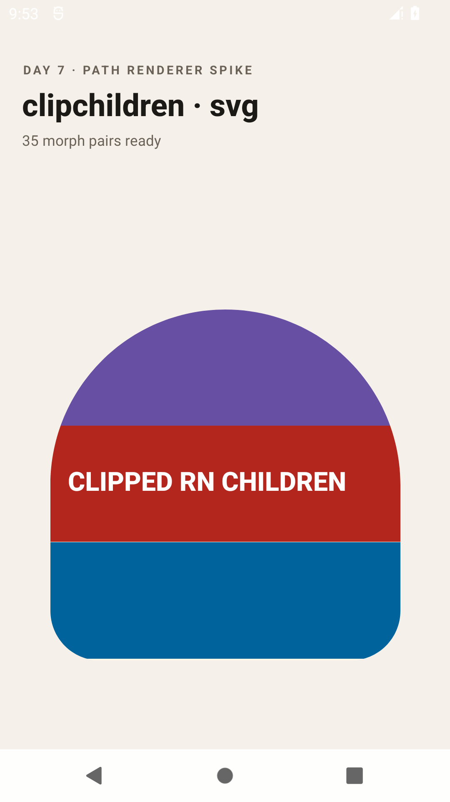
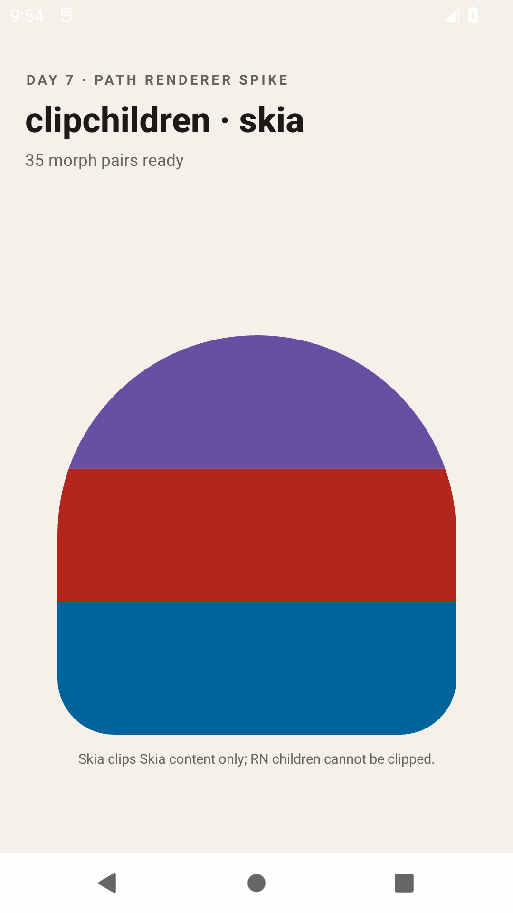

# Day 7 — clipping React Native children to a morphing path

**Spike:** `m3egallery://?spike=clipchildren&renderer=<svg|skia>` on `emulator-5554`
(API 31, 1080×1920, 2.625×), release/Hermes, RN 0.88.1, New Architecture.

## What each renderer does

- **SVG** — `clipPath` contains the animated morph path; a `G clipPath=…` wraps a
  `foreignObject` that hosts a real RN `View` with three child `View` bands and an RN
  `Text`. The capture shows all of it clipped to the morph.
- **Skia** — `Group clip={path}` clips only the Skia paths drawn inside the canvas. RN
  views are separate native views above/below the canvas and are not part of Skia's
  display list, so they cannot be clipped by the canvas. The capture shows the three
  Skia-drawn bands clipped, with the explanatory RN `Text` outside the shape.

| SVG — real RN children clipped | Skia — only Skia content clipped |
|---|---|
|  |  |

## Consequence

`ShapeContainer` must clip arbitrary RN content, not just paths drawn by the library.
This is a functional requirement for shaped containers, avatars and media slots, so it
is the deciding constraint in ADR-002. `react-native-svg` is the 1.0 renderer.

## Caveat

This is **visual clipping only**. `ShapeContainer` does not clip touch targets or
hit-testing to the path; the interactive area stays rectangular. The primitive documents
this limitation. A path-accurate hit test would be a separate feature and is not part of
1.0.
