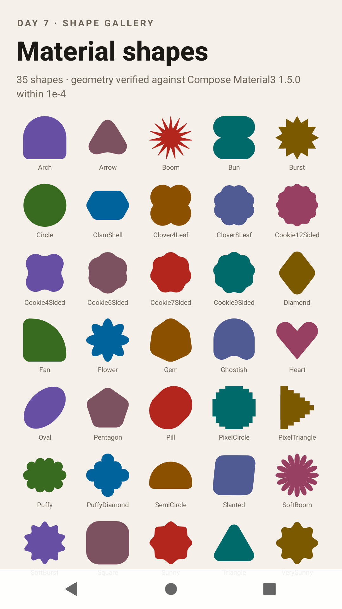
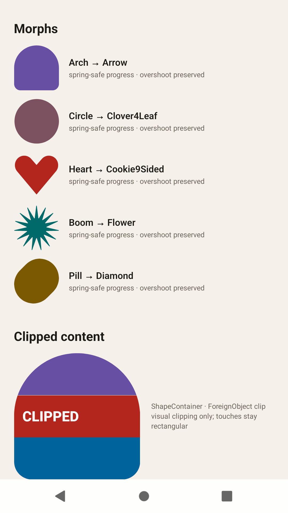

# Day 7 — shape gallery

**Route:** `m3egallery://?screen=shapes` (release gallery, `emulator-5554`, API 31,
1080×1920, 2.625×).

| All 35 shapes | Morphs and clipped content |
|---|---|
|  |  |

## What it shows

- **Grid:** all 35 `MATERIAL_SHAPE_NAMES` in canonical cycle order, rendered by the
  `Shape` primitive (`PathCanvas` → SVG path → `#6750A4`/palette fill). Geometry is the
  Day 6 golden geometry, verified within `1e-4` against Compose Material3 1.5.0.
- **Morphs:** five `MorphingShape` rows driven by Reanimated `withRepeat`/`withTiming`.
  Progress is passed straight through; `Morph` extrapolates outside `[0, 1]` (ADR-011,
  U-28), so a spring with overshoot is safe.
- **Clipped content:** `ShapeContainer` morphs `Arch → Clover4Leaf` and clips three real
  RN `View` bands plus an RN `Text`. The clip is visual only; touch targets remain
  rectangular.
- The screenshots show different morph phases between captures, confirming the shared
  values are animating on the UI thread.

## Device-side checks

- No ReactNativeJS errors during launch or scrolling.
- All 35 shapes render with the expected silhouettes and no missing/blank cells.
- The static 35-shape grid is separately diffed against Compose:
  `docs/evidence/day7/static-diff/` (0 AA-aware differing pixels).

The 8px cell labels are gallery chrome, not library typography; they are intentionally
small to fit five columns on a 360dp-wide screen.
