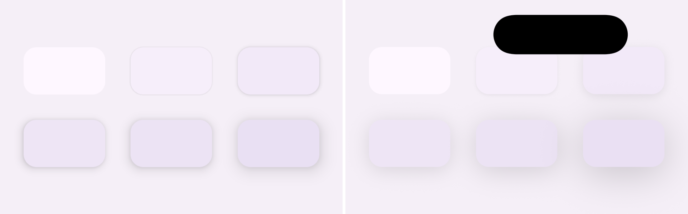

# Day 9 — iOS elevation approximation

**Status:** captured and reviewed. This is an **approximation**, not a pixel
match. Android is the elevation gate; iOS is inspection only (Core Rule 3,
ADR-004, ADR-019).

## Capture

| Item | Value |
|---|---|
| Device | iPhone 17 Pro simulator (`D826ADD7-BFFA-4677-B89B-B2E0060AE4C2`) |
| OS | iOS 26.5 |
| Build | Expo prebuild, Release, `xcodebuild -sdk iphonesimulator` |
| Scale | 3× (screenshot 1206×2622; scene crop 960×600) |
| Route | `m3egallery://?name=elevation-levels` |
| Scene | 320×200 dp, background `#F5EFF7`, levels 0/1/3/6/8/12 |

The app reads `Linking.getInitialURL()` once at mount, so the route must be
opened while the app is terminated. `xcrun simctl openurl` shows iOS's
"Open in M3E Gallery?" confirmation; the capture was taken after confirming.
The iPhone 17 Pro dynamic island is visible above the top row; it does not
overlap any tile. The status bar is hidden by the harness.

The Android side is the existing `elevation-levels` diff capture from
`docs/evidence/day9/diff/`, resampled from 840×525 (2.625×) to 960×600 so both
panels represent the same 320×200 dp scene.

## Side-by-side



- Left: Android 13 emulator, Compose Material3 1.5.0 `Surface`.
- Right: iOS 26.5 simulator, `Surface` with `elevationToIosShadow`.

## Tonal colour: exact on 5/6 levels

Sampled at each tile centre. The expected values are the library's tonal
formula outputs (ADR-018 / `surfaceColorAtElevation`).

| Level | Android (Compose) | iOS (RN) | Δ |
|---:|---|---|---:|
| 0 | `#FEF7FF` | `#FEF7FF` | 0 |
| 1 | `#F6EEFA` | `#F6EEFA` | 0 |
| 3 | `#F2E9F8` | `#F2E9F8` | 0 |
| 6 | `#EEE5F5` | `#EEE5F5` | 0 |
| 8 | `#ECE3F4` | `#ECE3F4` | 0 |
| 12 | `#E9E0F3` (233,224,243) | `#EAE0F3` (234,224,243) | 1/255 red |

The level-12 difference is Compose/Skia's 8-bit conversion of the tonal
composite, not a different formula. It is the same 1/255 difference the
Android diff records (`elevation-levels`: exact 22,350 px, max delta 1,
AA-aware 0). The AA-aware gate is unaffected.

## Shadow profile: softer and broader on iOS

Method: for each tile, sample a band 2–24 dp below the tile, ±30 dp around the
centre. `depth` is the background luminance `245,239,247` minus the darkest
pixel; `mean` is the same band's mean darkness. Higher depth = darker peak;
higher mean = more total shadow.

| Level | Android depth | iOS depth | Android mean | iOS mean |
|---:|---:|---:|---:|---:|
| 0 | 0.0 | 1.0 | 0.0 | 0.2 |
| 1 | 8.8 | 10.0 | 0.9 | 2.4 |
| 3 | 19.3 | 16.1 | 3.7 | 9.8 |
| 6 | 25.3 | 18.3 | 9.0 | 12.7 |
| 8 | 26.3 | 22.0 | 11.6 | 16.8 |
| 12 | 27.1 | 27.1 | 15.4 | 22.9 |

The iOS shadow is broader and softer: the mean darkness is higher at every
level, while the peak is lower at levels 3/6/8 and equal at level 12. This is
the expected consequence of mapping a RenderNode ambient+spot shadow onto
`shadowOpacity`/`shadowRadius`/`shadowOffset`. It is monotonic with elevation
and preserves hierarchy, but it is not the same shadow. Do not use these
screenshots as a pixel gate.

Machine-readable: `shadow-profile.json`.

## Reproduce

```bash
cd apps/gallery
CI=1 npx expo prebuild -p ios --no-install
cd ios && RUBYOPT=-rlogger pod install
xcodebuild -workspace M3EGallery.xcworkspace -scheme M3EGallery \
  -configuration Release -sdk iphonesimulator \
  -destination 'platform=iOS Simulator,name=iPhone 17 Pro' \
  -derivedDataPath /tmp/m3e-ios-build CODE_SIGNING_ALLOWED=NO
xcrun simctl boot 'iPhone 17 Pro'
xcrun simctl install booted /tmp/m3e-ios-build/Build/Products/Release-iphonesimulator/M3EGallery.app
xcrun simctl terminate booted com.nasyxrakeeb.m3egallery 2>/dev/null || true
xcrun simctl openurl booted 'm3egallery://?name=elevation-levels'
# Confirm "Open" in the simulator, then:
xcrun simctl io booted screenshot ios-elevation-levels-full.png
```

The capture is cropped to the 960×600 scene at (0,0) with
`tools/pixel/lib.mjs` (`cropPng`). The Android panel is the
`elevation-levels` capture resampled to 960×600 with `sips -z 600 960`.
